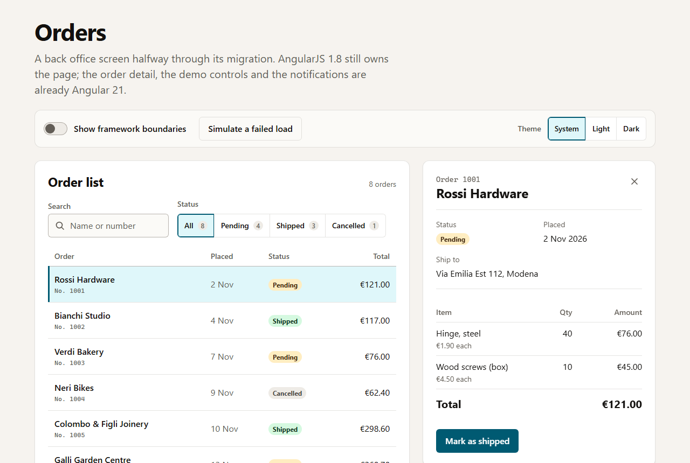
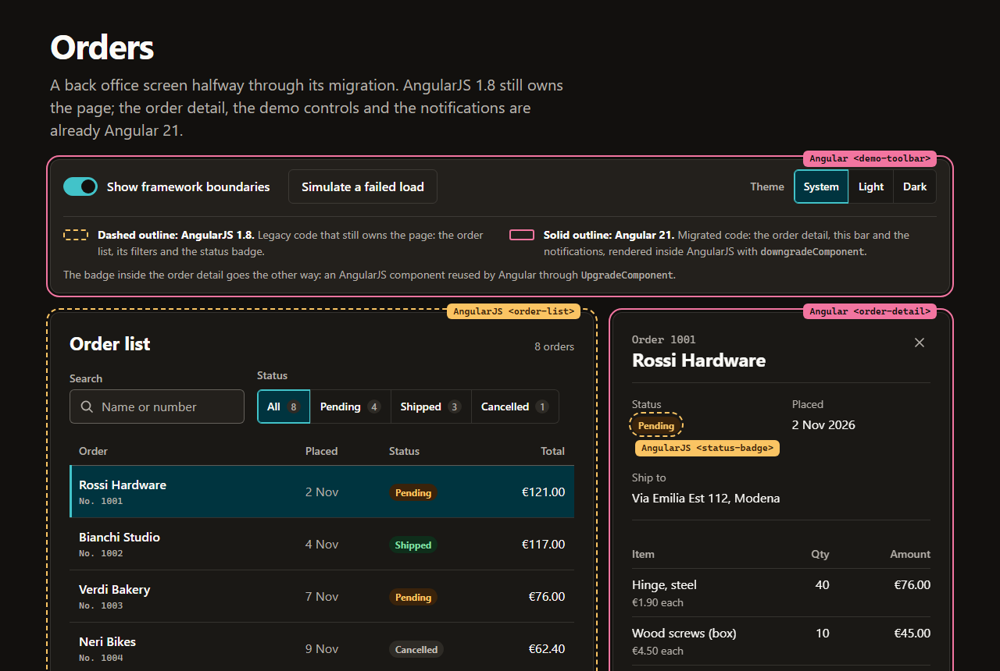
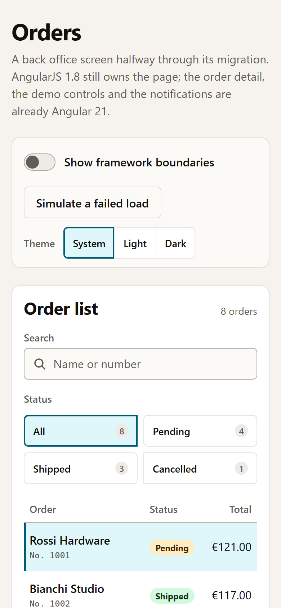

# AngularJS to Angular, one piece at a time

A small, runnable example of an **incremental** migration from AngularJS 1.8 to Angular with
`@angular/upgrade/static` (ngUpgrade). The app is a tiny orders screen. It is deliberately in the
middle of the migration: a **hybrid app** where AngularJS and Angular run on the same page, share
services and render each other's components.







## What the demo shows

| Piece | Lives in | Technique |
| --- | --- | --- |
| Hybrid bootstrap | `src/app/app.module.ts` | Angular boots first, then `UpgradeModule.bootstrap()` starts AngularJS on `document.body` |
| `OrdersService` | `src/app/orders.service.ts` | Migrated to Angular, given back to AngularJS with `downgradeInjectable`. State in signals, read by both frameworks |
| `appConfig` | `src/legacy/app-config.ts`, `src/app/app-config.provider.ts` | Still an AngularJS value, read from Angular through an upgraded provider (`deps: ['$injector']`) |
| `<order-list>` | `src/legacy/order-list.component.ts` | AngularJS 1.5+ component that still owns the page |
| `<order-detail>` | `src/app/order-detail.component.ts` | Migrated leaf component, used inside the AngularJS template with `downgradeComponent`. Signal input, `OnPush` |
| `<demo-toolbar>`, `<undo-toast>` | `src/app/demo-toolbar.component.ts`, `src/app/undo-toast.component.ts` | New features written in Angular from day one, placed in `index.html` and rendered by AngularJS through `downgradeComponent` |
| `<status-badge>` | `src/legacy/status-badge.component.ts`, `src/app/status-badge.directive.ts` | AngularJS component reused from Angular through an `UpgradeComponent` wrapper |
| `orderStatusLabel` | `src/legacy/order-status.filter.ts` | AngularJS filter, not migrated yet |

Turn on **Show framework boundaries** to see which framework renders what: AngularJS parts get a
dashed outline, Angular parts a solid one, each with a label naming the component. The address
`/?boundaries=on` opens the page in that mode.

Click "Mark as shipped" in the Angular panel: the status changes in the AngularJS table too. The
Angular event runs inside the Angular zone, and `UpgradeModule` triggers an AngularJS `$digest`
when the zone settles, so both worlds stay in sync. The update is optimistic: the order shows as
shipped at once, a toast offers Undo, and the simulated save runs in the background. Order 1006
has no shipping address, so its save fails and the change is rolled back with an explanation.
"Simulate a failed load" shows the loading skeleton and then the error state with a retry.

Versions: Angular 21.2, AngularJS 1.8.3, TypeScript 5.9, built with the Angular CLI
application builder (esbuild). Unit tests run on Vitest with jsdom.

## Run it

Requires Node `^20.19`, `^22.12` or `>=24`.

```bash
npm ci
npm start          # dev server on http://localhost:4200
npm run build      # production build in dist/orders-hybrid/browser
npm test           # unit tests, headless (Vitest + jsdom)
```

## Order of operations

The repository holds the state after step 5. The steps below are the sequence I follow on real
projects; each one keeps the application shippable. If you rebuild the history, a tag per step
(`step-0-legacy` to `step-7-angular-only`) makes the diffs easy to read.

0. **Inventory** (`step-0-legacy`). List modules, controllers, directives, filters, services,
   routes and third party AngularJS libraries. Mark the leaves (components with no children) and
   the services everything depends on. Note what has tests and what does not.
1. **TypeScript and a bundler** (`step-1-typescript`). Move from script tags to ES modules with
   `import angular from 'angular'`, compiled by TypeScript and bundled by the Angular CLI. No
   behaviour change. AngularJS still bootstraps with `ng-app`.
2. **Component style** (`step-2-components`). Rewrite controllers and directives as AngularJS 1.5+
   components with one-way `<` bindings and `&` callbacks, no `$scope` in controllers, `strictDi`
   on. This is the shape that maps one to one onto Angular components.
3. **Services first** (`step-3-services`). Migrate stateless and data services to Angular
   `@Injectable` classes and register them in AngularJS with `downgradeInjectable`. Legacy code
   keeps injecting them by the old name.
4. **Hybrid bootstrap** (`step-4-hybrid`). Remove `ng-app`, bootstrap an Angular `NgModule`
   that imports `UpgradeModule`, and start AngularJS from `ngDoBootstrap`. From here both
   frameworks run on the page.
5. **Leaf components** (`step-5-leaf-components`, this repository). Migrate components from the
   leaves up and use them in AngularJS templates with `downgradeComponent`. When an Angular
   component still needs an AngularJS child, wrap the child with `UpgradeComponent` until it moves.
   New features are written in Angular straight away and downgraded the same way.
6. **Routing** (`step-6-routing`). Move routes to the Angular router once most screens are
   Angular. During the transition both routers can coexist, each owning its own URLs (see
   `setUpLocationSync` in the upgrade docs).
7. **Remove AngularJS** (`step-7-angular-only`). Delete the last AngularJS module, `UpgradeModule`,
   the `angular` package and the wrappers. Bootstrap a standalone root component and, if you want,
   drop `zone.js` and move to zoneless change detection.

## Pitfalls

- **Change detection across the two worlds.** `UpgradeModule` hooks into `NgZone` to run
  `$digest` after Angular work. Since Angular 21 new apps are zoneless by default, so the hybrid
  module opts back in with `provideZoneChangeDetection()` and loads `zone.js`. Code that runs
  outside the zone (third party callbacks, `setTimeout` in `runOutsideAngular`) must call
  `$scope.$applyAsync()` or `NgZone.run()` or the other side will not see the change.
- **Shared mutable objects.** If both sides hold the same objects and AngularJS mutates them, an
  `OnPush` Angular component never sees the change. Here the service keeps the orders in a signal
  and replaces them on every update, and AngularJS passes the detail an id (`[order-id]`), not the
  object, so the detail reads the current order from the service.
- **Signal inputs and `OnPush` on downgraded components.** They work: the downgrade adapter in
  `@angular/upgrade/static` writes signal inputs through the signal node and marks the view for
  check when an AngularJS binding changes (checked in the Angular 21.2 source). `output()` works
  too, because the adapter only needs `subscribe`. The `UpgradeComponent` wrapper is different: it
  forwards inputs to AngularJS from its own `ngOnChanges`, so `StatusBadgeDirective` keeps the
  decorator `@Input`.
- **Angular promises in AngularJS code.** The list wraps `ordersService.load()` in `$q.when()`, so
  AngularJS digests when the promise settles even if the call runs outside the Angular zone, and
  in unit tests, where no zone drives the digests.
- **`$scope` and `$watch`.** Controllers that use `$scope.$watch` or `$scope.$on` do not
  translate. Replace watches with `$onChanges` (AngularJS) and then `ngOnChanges` or signal inputs
  (Angular), and events with outputs or a service.
- **Digest cost.** Every Angular event triggers a full AngularJS digest. Big `ng-repeat` lists with
  many watchers get slower in a hybrid app, so migrate them early or use one-time bindings (`::`).
- **Upgradable AngularJS components.** `UpgradeComponent` supports components with `bindings`,
  `template` (or a cached `templateUrl`) and lifecycle hooks. It does not support `compile`,
  `replace: true`, `terminal` or `transclude` functions.
- **AngularJS from npm.** When AngularJS is imported instead of loaded by a script tag, call
  `setAngularJSGlobal(angular)`, otherwise the app fails with "AngularJS v1.x is not loaded".
- **Downgraded component bindings.** In AngularJS templates inputs use `[order-id]="..."` and
  outputs use `(closed)="..."`: the Angular names, dash cased like any AngularJS attribute.
- **Routing.** Two routers fighting over the URL is the most common source of bugs. Give each
  router a clear set of routes and move whole screens, not halves.
- **Tests.** Angular specs cannot render an upgraded AngularJS component without a running
  AngularJS injector: replace it with a stub (see `order-detail.component.spec.ts`). AngularJS code
  that depends on downgraded services can be tested with `createAngularJSTestingModule`
  (see `order-list.component.spec.ts`). To render an AngularJS template that contains a
  downgraded component without bootstrapping Angular, remove that directive in a test module with
  `$provide.decorator('orderDetailDirective', () => [])`.

## Design and accessibility

The demo is small, but it is built the way a real back office screen should be.

- **Tokens.** `src/styles.css` defines primitives (an OKLCH palette of warm neutrals, a deep teal
  accent and status hues; a 4 px based spacing scale; six type sizes; three radii; motion
  durations) and semantic roles on top (`--surface`, `--text-secondary`, `--accent`,
  `--status-pending-bg`, `--boundary-ng` and so on). Components use only the semantic roles. One
  global stylesheet serves both frameworks, because AngularJS has no component styles. No UI
  framework, no web font.
- **Themes.** Each semantic role is written once with `light-dark()`, so its dark value sits next
  to the light one. The page follows `prefers-color-scheme`; the Theme control (System, Light,
  Dark) pins a choice by setting `color-scheme` on `<html>`. The choice is stored in
  `localStorage` behind `try`/`catch`, and a short inline script applies it before the first
  paint, so a dark choice never flashes light. Contrast is AA in both themes (checked with axe).
- **Framework boundaries.** The toggle is a button with `aria-pressed` that sets
  `data-boundaries` on `<html>`. Outlines take no space, so nothing shifts. Line style (dashed for
  AngularJS, solid for Angular) and a text label carry the meaning; colour only reinforces it.
- **States.** The list has all four: a loading skeleton with the same row shape as the data
  (`aria-busy` on the table), loaded, a "no results" state that names the query and offers Clear
  filters, and an error state (`role="alert"`) with Try again that keeps the filters. A polite
  live region says how many orders are shown.
- **Optimistic update with undo.** Shipping updates the list and the detail at once. The toast
  message is a polite live region that stays in the DOM; its buttons sit outside it. The toast
  stays 8 seconds and pauses while hovered or focused. Undo and dismiss move focus to the ship
  button or the row before their buttons disappear. After shipping, the ship button uses
  `aria-disabled` rather than `disabled`, so focus stays on it and the next Tab reaches Undo.
- **Keyboard.** Real buttons everywhere, a visible `:focus-visible` ring and a skip link. The
  table rows are one Tab stop (roving `tabindex`): arrow keys, Home and End move between them,
  Enter opens the order. Escape closes the detail. Status filter and theme are native radio groups.
- **Responsive.** Mobile first. From 56rem the list and the detail sit side by side, with the
  detail sticky. Below that it is master and detail: choosing an order shows the detail and moves
  focus to its heading, and "Back to orders" returns focus to the row. At 390 px the date column
  hides and the status filter becomes a two by two grid. No horizontal scroll, touch targets of at
  least 44 px, and a 16 px search input so iOS does not zoom on focus.
- **Motion.** Short transitions on `opacity` and `translate` only, all turned off under
  `prefers-reduced-motion`.

### Bundle

The production budget in `angular.json` warns at 425 kB and fails at 450 kB of initial JavaScript
and CSS. Before this redesign the initial bundle was 391 kB raw (120 kB transferred); now it is
419 kB raw (126 kB transferred), of which 19 kB raw (4 kB transferred) is the stylesheet. Most of
the JavaScript is AngularJS (185 kB) and Angular core (109 kB). The detail formats money and dates
with small `Intl` based pipes instead of `CurrencyPipe` and `DatePipe`, which keeps
`@angular/common` out of the bundle and saved about 19 kB.

## Further reading

- [Upgrading from AngularJS to Angular](https://angular.dev/upgrade) (official guide)
- [`@angular/upgrade/static` API](https://angular.dev/api/upgrade/static)
- [Angular modernization](https://riverdevstudio.it/angular-modernization), if you need an
  AngularJS or Angular app analysed or upgraded

## In italiano

Questo repository mostra un'applicazione ibrida funzionante: AngularJS e Angular sulla stessa
pagina, un servizio già migrato e condiviso con `downgradeInjectable`, un componente migrato usato
da AngularJS con `downgradeComponent` e un componente AngularJS riusato da Angular con
`UpgradeComponent`. Il pulsante "Show framework boundaries" evidenzia quale framework disegna ogni
parte della pagina.

Per un'analisi o un aggiornamento di un'applicazione AngularJS o Angular puoi scrivermi dalla
pagina [Modernizzazione Angular](https://riverdevstudio.it/it/modernizzazione-angular).

## License

MIT, Emanuel Pinto.
